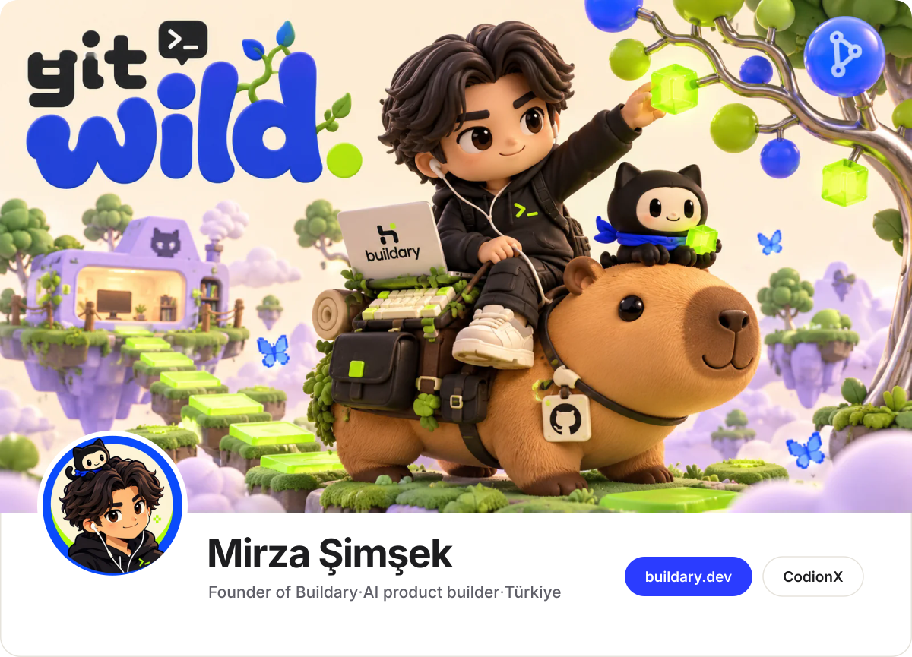
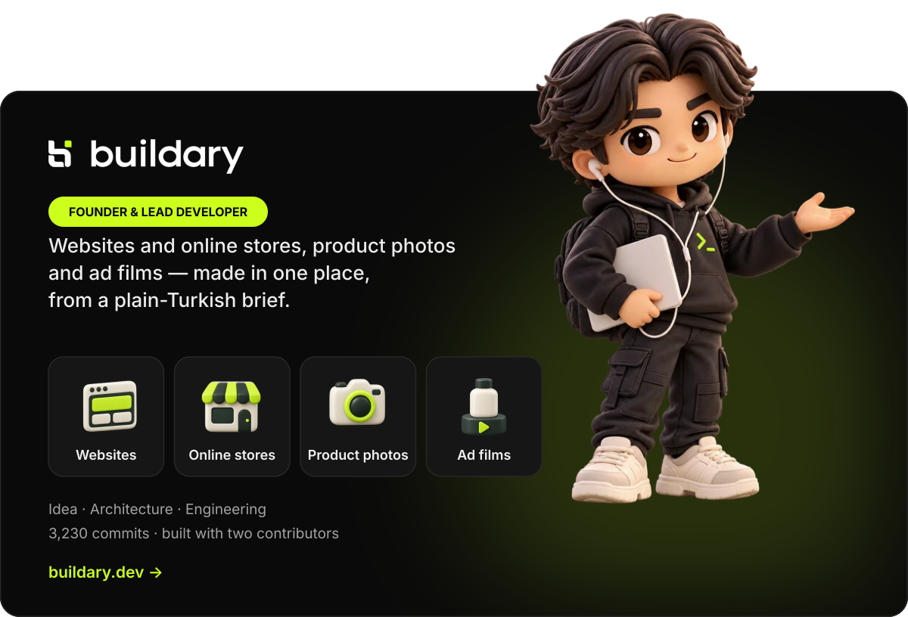
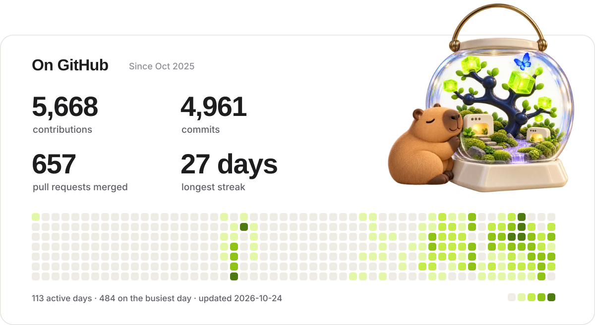
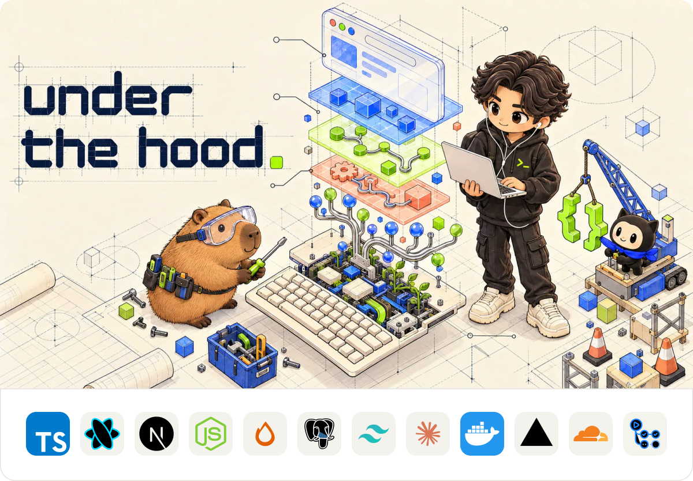
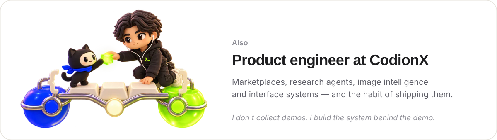
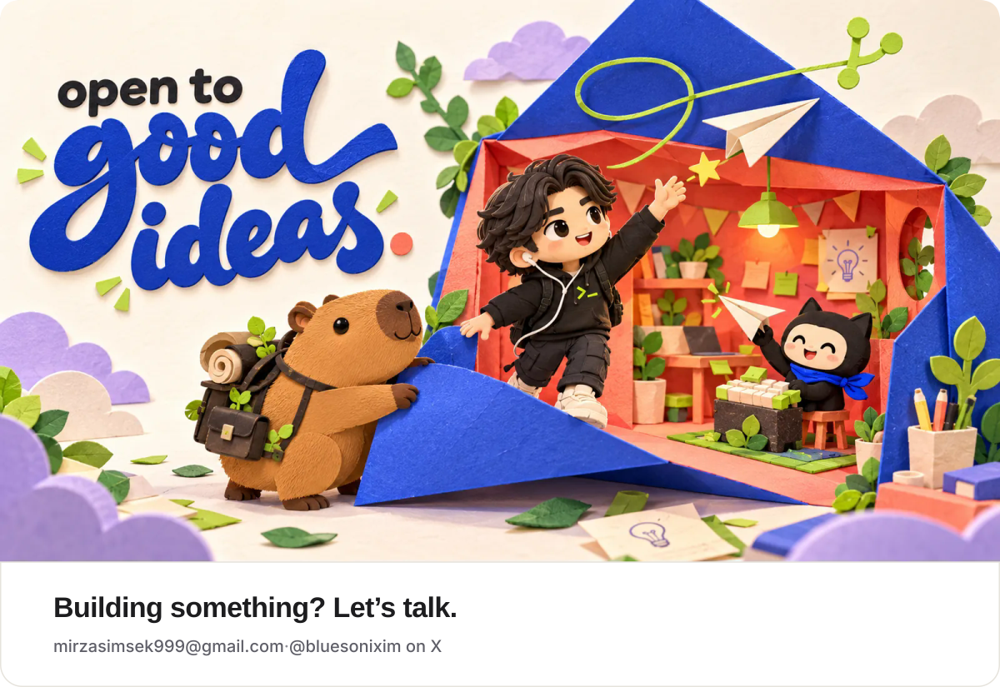
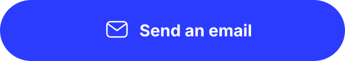
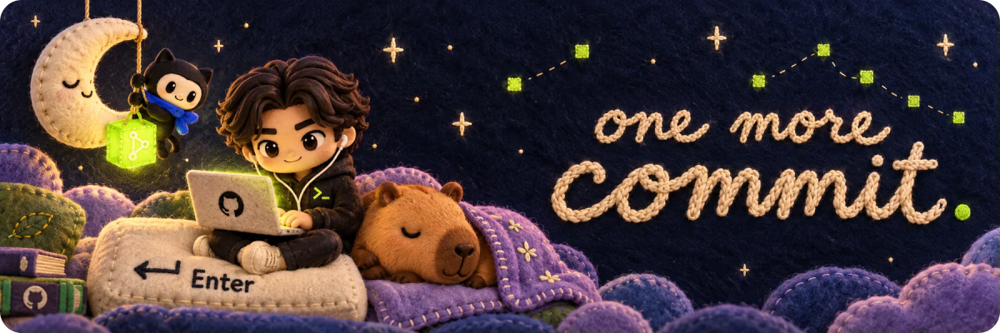

  <picture>
    <source media="(max-width: 700px) and (prefers-color-scheme: dark)" srcset="./assets/profile-mobile-dark.svg" />
    <source media="(max-width: 700px)" srcset="./assets/profile-mobile-light.svg" />
    <source media="(prefers-color-scheme: dark)" srcset="./assets/profile-dark.svg" />
    
  </picture>

  <a href="https://buildary.dev"><picture>
    <source media="(max-width: 700px) and (prefers-color-scheme: dark)" srcset="./assets/buildary-mobile.svg" />
    <source media="(max-width: 700px)" srcset="./assets/buildary-mobile.svg" />
    
  </picture></a>

  <picture>
    <source media="(max-width: 700px) and (prefers-color-scheme: dark)" srcset="./assets/github-mobile-dark.svg" />
    <source media="(max-width: 700px)" srcset="./assets/github-mobile-light.svg" />
    <source media="(prefers-color-scheme: dark)" srcset="./assets/github-dark.svg" />
    
  </picture>

  <picture>
    <source media="(max-width: 700px) and (prefers-color-scheme: dark)" srcset="./assets/stack-mobile-dark.svg" />
    <source media="(max-width: 700px)" srcset="./assets/stack-mobile-light.svg" />
    <source media="(prefers-color-scheme: dark)" srcset="./assets/stack-dark.svg" />
    
  </picture>

  <a href="https://codionx.com"><picture>
    <source media="(max-width: 700px) and (prefers-color-scheme: dark)" srcset="./assets/also-mobile-dark.svg" />
    <source media="(max-width: 700px)" srcset="./assets/also-mobile-light.svg" />
    <source media="(prefers-color-scheme: dark)" srcset="./assets/also-dark.svg" />
    
  </picture></a>

  <a href="mailto:mirzasimsek999@gmail.com"><picture>
    <source media="(max-width: 700px) and (prefers-color-scheme: dark)" srcset="./assets/contact-mobile-dark.svg" />
    <source media="(max-width: 700px)" srcset="./assets/contact-mobile-light.svg" />
    <source media="(prefers-color-scheme: dark)" srcset="./assets/contact-dark.svg" />
    
  </picture></a>

  <a href="mailto:mirzasimsek999@gmail.com"><picture><source media="(prefers-color-scheme: dark)" srcset="./assets/button-mail-dark.svg" /></picture></a>
  <a href="https://x.com/bluesonixim"><picture><source media="(prefers-color-scheme: dark)" srcset="./assets/button-x-dark.svg" /></picture></a>

  <picture>
    <source media="(max-width: 700px) and (prefers-color-scheme: dark)" srcset="./assets/footer-mobile.svg" />
    <source media="(max-width: 700px)" srcset="./assets/footer-mobile.svg" />
    
  </picture>

